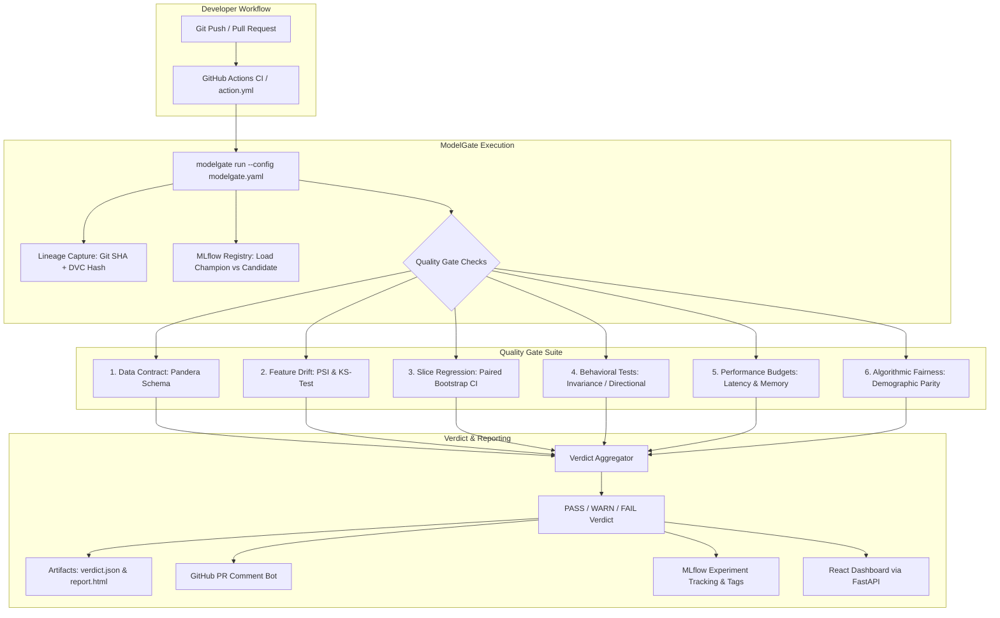

# ModelGate

[](https://github.com/your-org/ModelGate/actions/workflows/ci.yml)
[](https://opensource.org/licenses/MIT)
[](https://www.python.org/downloads/)
[](https://github.com/your-org/ModelGate)

**ModelGate** is an open-source CI/CD quality gate for machine learning models that intercepts pull requests changing model code, hyperparameters, or training data. Acting as automated code review and unit testing for ML, it runs a battery of six statistical and operational checks—data contracts, feature drift, slice regressions with paired bootstrap confidence intervals, behavioral invariance, performance budgets, and algorithmic fairness—blocking regressions before they reach production.

---

## Real Output & Dashboard

### 1. GitHub PR Comment Bot (`modelgate_output/pr_comment.md`)
When executed on a pull request, `modelgate run` writes `modelgate_output/pr_comment.md` (via `build_pr_comment` in `src/modelgate/report.py`):

```markdown
## ModelGate verdict: PASS

**Candidate** `30405b4` | seed 42 | data `43737ff0...`

| Check | Status | Summary |
|---|---|---|
| Data Contract | ✅ PASS | 0 violations |
| Drift | ✅ PASS | Max PSI 0.02, no significant drift |
| Slices | ✅ PASS | No slice regression detected (overall f1: 0.879) |
| Behavioral | ✅ PASS | flip rate 0.0% |
| Budgets | ✅ PASS | p95 21.5ms, size 0.1MB, mem 0.1MB |
| Fairness | ✅ PASS | demographic_parity_diff 0.00 |
```

---

### 2. React Dashboard (`http://localhost:3000`)
The Vite + React dashboard (`dashboard/src/`) queries the FastAPI backend (`http://localhost:8000`) and exposes five views:
- **Runs (`/`) & Run Detail (`/runs/:id`)**: Run list with status/branch filtering, per-check verdicts, slice bootstrap CI breakdown, and run approval controls.
- **Models (`/models`)**: Registered model runs and active champion indicator.
- **Compare (`/compare`)**: Side-by-side metric comparison (`GET /compare?a=<id>&b=<id>`).
- **Benchmark (`/benchmark`)**: Fault-injection benchmark summary loaded from `GET /bench`.
- **Settings (`/settings`)**: Project configuration and API token settings.

---

## Quickstart (3 Commands)

Get ModelGate running locally with the credit-risk demo in 3 commands:

```bash
# 1. Install ModelGate with development dependencies
pip install -e ".[dev]"

# 2. Train baseline model and generate demo datasets
python demo/train.py

# 3. Execute the full ModelGate quality check suite
modelgate run --config modelgate.yaml
```

*To launch the full API, MLflow, and Dashboard stack via Docker:*
```bash
docker compose up -d
```

---

## Architecture Diagram



---

## Benchmark Headline Result

A comprehensive fault-injection benchmark comparing **ModelGate** against a standard **Accuracy-Only Baseline** across **30 independent seeds** per fault mode:

| Fault Injected | Defect Description | ModelGate Detection Rate | Accuracy-Only Baseline | Winner |
| :--- | :--- | :---: | :---: | :---: |
| **`feature_leakage`** | Target derived column added to training data | **100%** | 100% | 🔵 Tie |
| **`label_shift`** | 40% label flips in `North` region subgroup | **93%** | 93% | 🔵 Tie |
| **`degraded_slice`** | 90% data drop on `North` region subgroup | **100%** | 3% | **✅ ModelGate (+97%)** |
| **`schema_drift`** | Unit scale change on `income` feature | **100%** | 40% | **✅ ModelGate (+60%)** |
| **`latency_regression`**| Substituted high-latency ensemble model | **100%** | 0% | **✅ ModelGate (+100%)** |
| **`fairness_regression`**| Disproportionate label flip on protected group | **43%** | 77% | ❌ Baseline |
| **`noop` (Control)** | Re-trained identical pipeline with new seed | **0% FP** | **0% FP** | **✅ ModelGate (No FPs)** |

> **Key Takeaway:** An accuracy-only metric catches only **3%** of silent subgroup degradations and **0%** of latency blowups. ModelGate detects **100%** of these defects while maintaining a **0% false-positive rate** on clean models. Full methodology available in [`docs/benchmark.md`](docs/benchmark.md).

---

## Project Structure

```
ModelGate/
├── .github/
│   └── workflows/
│       ├── ci.yml                 # Lint (ruff), type check (mypy), tests (pytest), dashboard build
│       └── modelgate.yml          # Reusable quality gate action invocation on PRs
├── action.yml                     # Reusable GitHub Composite Action
├── docker-compose.yml             # Local multi-service stack (API, MLflow, Dashboard, Seed)
├── Dockerfile                     # Multi-stage container for ModelGate API & CLI
├── pyproject.toml                 # Package configuration, Hatchling build, pytest & ruff settings
├── modelgate.yaml                 # Quality gate configuration file
├── data.dvc                       # DVC lockfile tracking SHA-256 data hash
├── data/                          # Reference, train, and test datasets
├── demo/
│   ├── train.py                   # Credit-risk demo dataset generation & training
│   └── contracts/
│       └── schema.py              # Pandera data contract schema
├── dashboard/                     # React + Vite TypeScript Dashboard
│   ├── src/
│   │   ├── pages/                 # Runs, Models, Compare, Benchmark, Settings
│   │   └── App.tsx                # Main router & layout
│   ├── nginx.conf                 # Production reverse-proxy config
│   └── Dockerfile                 # Multi-stage Node/Nginx container
├── docs/
│   ├── architecture.md            # System design, data flow, and check mechanics
│   ├── usage.md                   # CLI commands, config schema, and CI/CD guide
│   ├── decisions.md               # Architecture Decision Records (ADRs)
│   ├── benchmark.md               # Fault-injection benchmark methodology & findings
│   └── benchmark_results.json     # Machine-readable 30-seed benchmark dataset
├── scripts/
│   ├── seed.py                    # Docker Compose seed script for initial demo data
│   └── run_bench_fast.py          # Parallel 30-seed benchmark runner
├── src/modelgate/                 # Core Python package
│   ├── cli.py                     # Typer CLI (modelgate run / bench / reproduce / init)
│   ├── config.py                  # Pydantic models for modelgate.yaml
│   ├── verdict.py                 # Verdict aggregator (PASS / WARN / FAIL)
│   ├── stats.py                   # Paired bootstrap CI, PSI, KS-test, Holm-Bonferroni
│   ├── report.py                  # HTML report & GitHub Markdown PR comment generation
│   ├── registry.py                # MLflow model registry champion/challenger interface
│   ├── lineage.py                 # Git SHA & DVC data hash extraction
│   ├── loader.py                  # Dynamic module & object loader
│   ├── benchmark.py               # Benchmark fault generators & runner
│   ├── api/                       # FastAPI backend
│   │   ├── main.py                # REST endpoints (/runs, /models, /settings, /health)
│   │   └── models.py              # SQLModel & Pydantic database models
│   ├── checks/                    # Quality gate check modules
│   │   ├── data_contract.py       # Pandera schema contract check
│   │   ├── drift.py               # Feature PSI & KS-test drift check
│   │   ├── slices.py              # Subgroup slice regression check with bootstrap CI
│   │   ├── behavioral.py          # Invariance and directional metamorphic check
│   │   ├── budgets.py             # Latency, model size, and peak memory check
│   │   └── fairness.py            # Demographic parity and equal opportunity check
│   └── integrations/
│       └── github/
│           └── pr_bot.py          # GitHub PR comment poster
└── tests/
    └── unit/                      # 63 unit tests across API, CLI, checks, stats, and reports
```

---

## License

ModelGate is open-source software licensed under the [MIT License](LICENSE).
